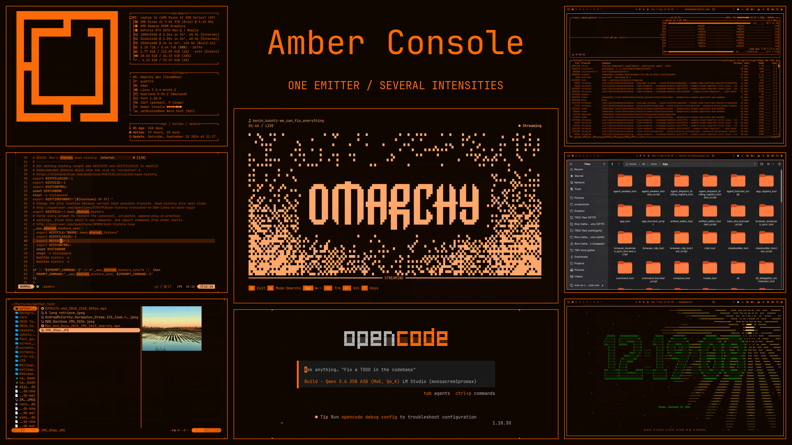

# Amber Console

**This Omarchy theme is a tribute to [DutchDiederik](https://github.com/DutchDiederik)'s excellent [AmberConsole](https://github.com/DutchDiederik/AmberConsole) html/css framework.**



## This copy

A personal fork of [zigmoo/omarchy-amber-console-theme](https://github.com/zigmoo/omarchy-amber-console-theme), kept in dotfiles and deployed by symlink. [UPSTREAM](UPSTREAM) records the commit it was copied from. On top of that copy, a design pass makes the whole desktop read as one AmberConsole neon panel: every neon token is used in the role the source gives it, and nothing outside the neon palette ships. [DESIGN.md](DESIGN.md) has the per-surface reasoning, the coverage table and the checks.

Tested on **Omarchy 4.0.0** (`d9cc361`). Apply with:

```bash
omarchy theme set amber-console
```

The theme appears as **Amber Console** in Omarchy's picker.

## One emitter, several intensities

AmberConsole takes its cues from hardware that could vary the brightness of a single emitter, rather than assign different hues to different meanings. This theme maps every named ANSI color to that same ramp. Errors, warnings and success states share it; text labels, symbols, intensity and inverse video carry the distinction.

The colors come from [AmberConsole's neon tokens](https://github.com/DutchDiederik/AmberConsole/blob/e616e1c04aaf65d67e485559745421c8226ec4b3/src/tokens/colors.css). The neon block is unchanged on AmberConsole `main` as of 2026-11-08. This is the neon profile; AmberConsole's separate P3 amber CRT profile has a different ramp.

### The fourteen tokens

These are the only colors the theme ships, in any file, directly or through a template.

| Token | Value | Role in this theme |
| --- | --- | --- |
| `--ac-screen` | `#100600` | The panel: every window, bar, card and terminal background. |
| `--ac-screen-raised` | `#1b0c02` | Lifted regions: cursorlines, added diff lines, hovered sidebar rows. |
| `--ac-screen-well` | `#060200` | Recessed regions: the lock input, meter troughs, removed diff lines, scrims. |
| `--ac-emit-100` | `#ffa86d` | ink-bright / fill-bright: the focused window, cursor, operator input, menu cursor row, errors. |
| `--ac-emit-90` | `#ff6b08` | ink / fill / stroke: body text, selection fill, dialog and panel borders. |
| `--ac-emit-70` | `#dd5800` | ink-dim: secondary text, info and success output, the focus ring. |
| `--ac-emit-50` | `#ab4500` | ink-faint / stroke-dim: comments, placeholders, unfocused borders. |
| `--ac-emit-30` | `#5b2500` | ink-trace: dividers and graticule lines. Decorative only, never text. |
| `--ac-on-fill` | `#1e0c00` | Text on any lit fill (inverse video). |
| `--ac-halo-1` | `255, 120, 30` | The focused window's glow and the hover tint (glow-box, 0.32 / 0.07). |
| `--ac-halo-2` | `255, 109, 12` | The pressed-control tint (mid text halo, 0.26). |
| `--ac-halo-3` | `255, 102, 0` | Focus spill and the text-selection tint (outer halo, 0.10 / 0.20). |
| `--ac-halo-4` | `255, 140, 64` | The hot edge on the menu cursor row and the lock-field selection (0.75 / 0.31). |
| scatter / spread | `1` / `1` | Neon is the reference, so every radius is used unscaled (the window glow is 8px). |

Halos are light, not ink. They appear only with alpha below 1, at the alphas `effects.css` gives them.

### The ANSI map

Sixteen slots, four legible drive levels. Severity climbs the ramp, and each bright slot sits one stop above its normal slot. `emit-30` is never used, because it fails every text gate.

| Slot | Normal | Bright | Why |
| --- | --- | --- | --- |
| black (0 / 8) | `screen` | `emit-50` | Slot 0 is the background in every Omarchy terminal template. Bright black is the muted slot: comments and autosuggestions at ink-faint. |
| green (2 / 10) | `emit-70` | `emit-90` | Success is nominal, so it stays quiet. |
| blue (4 / 12) | `emit-70` | `emit-90` | Directories and info: secondary text. |
| cyan (6 / 14) | `emit-70` | `emit-90` | Strings and links: secondary text. |
| yellow (3 / 11) | `emit-90` | `emit-100` | Warnings carry primary-text weight. |
| magenta (5 / 13) | `emit-90` | `emit-100` | Keywords and special tokens. |
| red (1 / 9) | `emit-100` | `emit-100` | Errors drive hardest. Bright red cannot go higher. |
| white (7 / 15) | `emit-90` | `emit-100` | Foreground and bright foreground. |

The upshot: the Alacritty search match (`yellow`, emit-90) and the focused match (`red`, emit-100) are now different, and warnings no longer look like errors.

### Inverse video

Where Omarchy offers a fill and text pair, the pair is a lit fill with `on-fill` text, as in `base/reset.css` `::selection` and `components/table.css` `.ac-table__row--active`:

- Text selection in every terminal and editor: `emit-90` fill, `on-fill` text.
- The Omarchy menu cursor row: `emit-100` fill, `on-fill` text, edged with halo-4.
- Hyprland group tabs: the active tab is `emit-90` fill with `on-fill` text, or `emit-100` in a locked group.
- The btop selected process row: `emit-90` fill, `on-fill` text.
- Terminal cursor, search matches and footer bar: lit fills. Omarchy's terminal templates bind that text to `background` (`#100600`), which still reads as inverse video.

Some places cannot show inverse video, because Omarchy paints the text from the same key as the fill or pins it to the normal ink. These include shell controls, lock and polkit errors, and text selection in shell fields. There the state is carried by drive level instead, as DESIGN.md explains.

## What the theme changes

- `colors.toml` supplies the palette for Omarchy's generated application themes.
- `shell.toml` colors every shell surface: bar, controls, popups, tooltips, notifications, menu, launcher, polkit, lock and image picker.
- `hyprland.lua` sets window and group borders, group tabs, the window glow and the empty-output color.
- `btop.theme`, `claude.json`, `hermes.yaml`, `pi.json`, `t3code.json` and `vscode-theme.json` replace generated files whose templates blend colors.
- `icons.theme` selects orange Yaru-dark folder icons.
- `unlock.png` and `preview-unlock.png` give the boot unlock screen an emit-100 logo.
- `backgrounds/` contains a generated graticule wallpaper and the IMAX photograph.

Fonts, layout, widgets and desktop behavior are inherited. The package contains no hooks, scripts, plugins or global configuration changes.

This is a small working palette and surface adaptation. Websites, images and independently styled truecolor output can still contain other colors; the theme does not simulate every hardware effect or typographic rule in the original design system.

## Wallpapers

`00-amber-graticule.png` sorts first, so it is the default. It is drawn only in tokens: unlit plasma cells in `screen-raised` on `screen`, an oscilloscope graticule in dotted `emit-30` with `emit-50` center axes, and a trace in lit cells. The trace's halo is stepped through the drive tiers (`emit-90` core, then `emit-50`, then `emit-30`) instead of blended, and its beam head runs at `emit-100`. A pixel check confirms that only token colors appear.

The IMAX photograph is kept as the second wallpaper. It contains colors outside the palette.

## With thanks

- **[DutchDiederik / Diederik](https://diederik.blog)** — AmberConsole's original design, hardware research and palette. Please visit [AmberConsole](https://github.com/DutchDiederik/AmberConsole); it is the heart of this theme.
- **[Jesse Palmer](https://x.com/RealJessePalmer/status/2080690462269259848)** — the IMAX console photograph.
- **[Bjarne Øverli](https://github.com/bjarneo/omarchy-evergreen-theme)** and the Omarchy theme community — the straightforward repository and installation conventions.
- [@DHH](https://x.com/dhh) for the amazing [@OmarchyLinux](https://x.com/OmarchyLinux)!!

The upstream **BSD-3-Clause** notice is retained in [LICENSE](LICENSE) for the theme. The IMAX photograph retains its original rights and is not covered by that license. The current `preview.jpg` montage contains application screenshots. Preview source assets, recipes and photo-based examples are preserved on the `theme_comp_tooling_dil-2723` branch.
