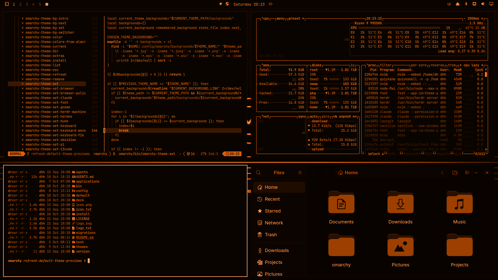
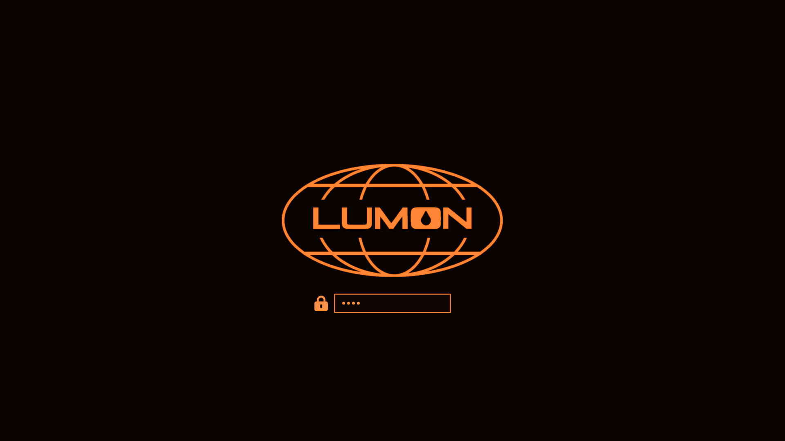

# Lumon Amber

An [Omarchy](https://omarchy.org) theme built on Lumon, relit with the
AmberConsole neon palette: one hue of plasma orange on near-black, like an
old monochrome terminal.



## Palette

Every amber value is an AmberConsole neon token, used in the role
AmberConsole assigns it. No stops are added. Where the five stops run out,
status colors leave the hue instead (see below).

| Token           | Hex       | Ratio | OKLab L | Role                                       |
| --------------- | --------- | ----- | ------- | ------------------------------------------ |
| `screen-well`   | `#060200` |       |         | Recessed well (darkest background)         |
| `screen`        | `#100600` |       |         | Base panel (main background)               |
| `screen-raised` | `#1b0c02` |       |         | Raised region (sidebars, floats)           |
| `on-fill`       | `#1e0c00` |       |         | Text on an `emit-90` fill                  |
| `emit-30`       | `#5b2500` | 1.63  | .337    | Trace: bright black, comments, ghosts      |
| `emit-50`       | `#ab4500` | 3.40  | .520    | Dim / disabled; blue, magenta, cyan        |
| `emit-70`       | `#dd5800` | 5.20  | .625    | Secondary ink: bright blue, magenta, cyan  |
| `emit-90`       | `#ff6b08` | 7.00  | .702    | Ink: fg, white, green, accent              |
| `emit-100`      | `#ffa86d` | 10.50 | .805    | Hot: yellow, bright yellow/white, cursor   |

### ANSI slots

The slots follow Lumon's structure: colored slots sit below the ink, and the
bright slots climb above it.

| Slot    | Normal                  | Bright                   |
| ------- | ----------------------- | ------------------------ |
| black   | `screen`                | `emit-30`                |
| red     | `#ff0043` (h20 cusp)    | `#ff465a` (h20 +10%)     |
| green   | `emit-90`               | `#00b05b` (P1 emit-90)   |
| yellow  | `emit-100`              | `emit-100`               |
| blue    | `emit-50`               | `emit-70`                |
| magenta | `emit-50`               | `emit-70`                |
| cyan    | `emit-50`               | `emit-70`                |
| white   | `emit-90`               | `emit-100`               |

Rules the theme follows:

- **One hue, except for red and bright green.** Red is a crimson matched to
  the amber by gamut position in OKLCH. `emit-90` sits on its hue's gamut
  cusp, so `red` is the cusp at h20 (`#ff0043`, 5.09:1), 25° from the ink.
  Red and ink differ by only 1.38:1 in luminance, so hue carries the error
  signal; CRT P22 red (h29.2) was just 15° away and read as amber.
  `bright_red` is 10% of the way from the cusp to white at full chroma
  (`#ff465a`, 5.99:1); `emit-100` goes 26.6%, but red turns
  salmon well before that. Matching luminance instead gives a pastel
  `#ff6666`, because red's cusp sits below 7:1. Blue, magenta, and cyan are
  `emit-50`; their brights are `emit-70`.
  - `green` is `emit-90`; `bright_green` is CRT P1's `emit-90` (7.02:1).
  - Yellow (warning) is `emit-100`, so warnings stand out from the ink.
- **Selection is inverse video.** Selected text is `on-fill` on `emit-90`.
  Lighter row and meter highlights use the `emit-30` trace.
- **Halos are glow only.** The glow colors (`#ff781e`, `#ff6600`) appear only
  in Hyprland window shadows, never as text.

## What's themed

| File             | Applies to                                                    |
| ---------------- | ------------------------------------------------------------- |
| `colors.toml`    | Omarchy's shared palette (terminals, launcher, bar, etc.), shell borders (`hyprland_*`), and app icon roles (`icon_*`) |
| `hyprland.lua`   | Window borders, group borders, and the glowing shadows        |
| `shell.menu.toml` | Menu/launcher rows: `emit-30` trace highlight with `emit-100` text |
| `shell.lock.toml` | Lock field: `emit-50` placeholder, `emit-30` selection       |
| `chromium.theme` | Chromium/Helium seed (`45,24,14` = `#2d180e`): Lumon's seed (`#0e1f29`, HCT chroma 15, tone 10.8) rotated to the ink's hue (h43.5) |
| `archive/`       | Disabled overrides (`neovim.lua`); Omarchy's templates are used instead |
| `backgrounds/`   | Wallpapers, plus matching intro videos in `backgrounds/intros/` |
| `unlock.png`     | Lock screen image                                             |

### Hyprland notes

- The focused window gets an `emit-100` border and an amber glow. Unfocused
  windows get a faint `emit-30` border and a very soft glow.
- The `special:qconsole` workspace (the drop-down console) has no shadow.
  It already stands out over the dimmed workspace, so a glow there would look
  like a mistake.

## Install

Put this folder in `~/.config/omarchy/themes/lumon-amber`, then run:

```sh
omarchy-theme-set lumon-amber
```

Or choose it from the Omarchy theme menu.

## Previews

| Desktop                  | Lock screen                            |
| ------------------------ | -------------------------------------- |
|   |      |
